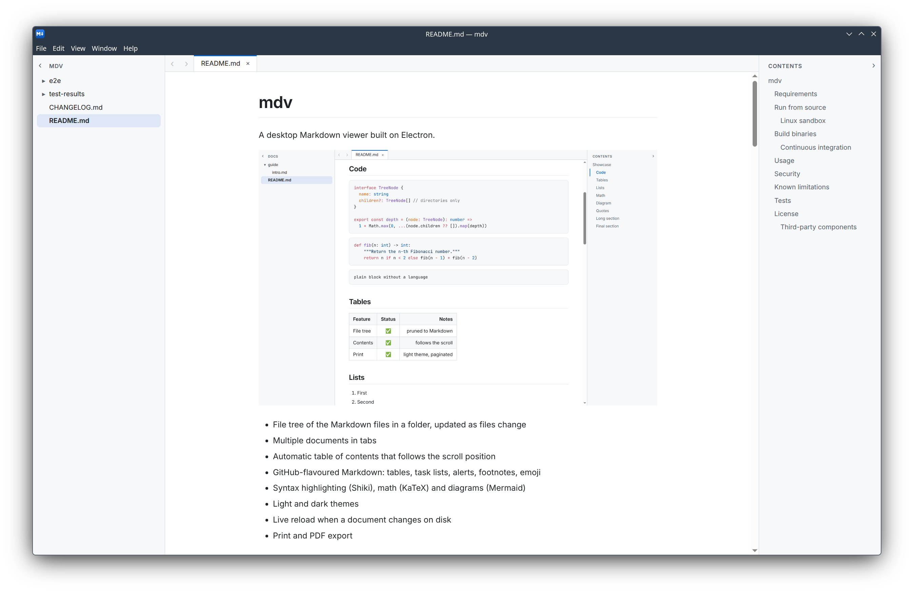
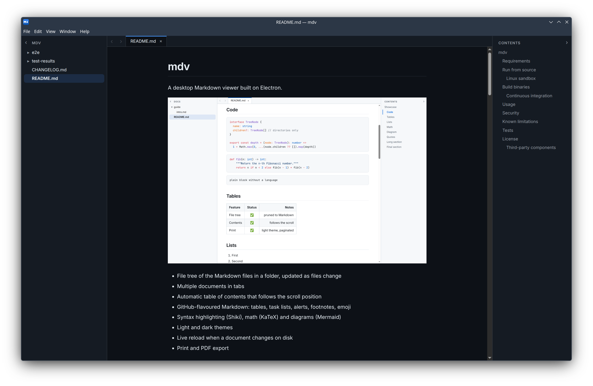

# mdv

A desktop Markdown viewer built on Electron.





- File tree of the Markdown files in a folder, updated as files change
- Multiple documents in tabs
- Automatic table of contents that follows the scroll position
- GitHub-flavoured Markdown: tables, task lists, alerts, footnotes, emoji
- Syntax highlighting (Shiki), including ARM, AArch64, Z80, 6502 and AVR assembly; math (KaTeX)
  and diagrams (Mermaid)
- Light and dark themes
- Live reload when a document changes on disk
- Print and PDF export

## Requirements

- Node.js 22.22.2 or newer on the 22 line, or 24.15 or newer, with npm
- `make` (optional, for the packaging shortcuts)

## Run from source

```sh
npm install
npm run dev                  # or: npm run dev -- <file-or-folder>...
```

### Linux sandbox

Ubuntu 24.04 and later deny user namespaces, which Chromium's sandbox needs, to programs without an
AppArmor profile; Electron then stops with `The SUID sandbox helper binary was found, but is not
configured correctly`. The deb installs a profile for the application. For development, install
one for this checkout, once:

```sh
make sandbox                 # asks for the root password
```

The command writes this profile to `/etc/apparmor.d/mdv-dev` and loads it, with `sudo`:

```
abi <abi/4.0>,
include <tunables/global>
profile mdv-dev "<checkout>/{node_modules/electron/dist/electron,dist/linux-unpacked/mdv}" flags=(unconfined) {
  userns,
}
```

It names two programs, both inside this checkout: the Electron that `npm run dev` and the tests
start, and the unpacked build. `flags=(unconfined)` leaves them unrestricted, as they were, and
`userns` adds the one permission they lacked: creating user namespaces. No other program and no
system setting is changed. The profile holds the path of the checkout, so run the command again if
the checkout moves.

To undo it:

```sh
sudo apparmor_parser --remove /etc/apparmor.d/mdv-dev
sudo rm /etc/apparmor.d/mdv-dev
```

## Build binaries

Packages are written to `dist/`.

```sh
make            # current platform
make linux      # deb and snap; the snap needs snapcraft 8 and LXD
make win        # NSIS installer; needs Wine when run on Linux
make mac        # dmg; must run on macOS
make clean      # remove out/ and dist/
```

Run a Linux build without installing it:

```sh
dist/linux-unpacked/mdv <file-or-folder>
```

### Continuous integration

On GitHub, every push to `master` and every pull request runs the type check, the unit tests and
the end-to-end tests. Pushing a tag such as `v0.1.0` builds the packages for Linux, Windows and
macOS and publishes them in a release; the Release workflow can also be started by hand, which only
builds them.

## Usage

```sh
mdv README.md notes.md       # each file opens in a tab
mdv ~/docs                   # opens the folder and its README, if any
```

If mdv is already running, these open in its window instead of starting a second one. Files and
folders can also be dropped on the window. Files ending in `.md`, `.markdown`, `.mdown`, `.mkd` or
`.mdx` are listed in the file tree; picking one opens it in a new tab. A file opened while no folder
is open brings the folder it is in into the file tree. Links between documents open in the current
tab; Ctrl+click or middle-click opens a new one, and middle-click on a tab closes it.

MDX files are shown as Markdown with their top-level `import` and `export` statements hidden. mdv
does not compile or run MDX, so the rest is rendered as plain Markdown:

- Components and other JSX tags go to the HTML sanitizer as raw HTML. A tag with plain attributes
  is removed and keeps its content, but a component named like an HTML element (`<Details>`,
  `<Button>`, `<Image>`) becomes that element, and a self-closing one (`<Details />`) wraps the
  rest of the document. A tag whose attributes hold expressions with spaces, quotes or spreads
  (`<Chart data={[1, 2]} />`, `<Card {...props}>`) is shown as source.
- Markdown on the lines between a component's opening and closing tags is not formatted unless
  blank lines separate it from the tags; Markdown on the same line as the tags is.
- `{expressions}` are not evaluated; in text they are shown as typed, apart from any Markdown
  inside them (`{a*b*c}` gets emphasis).
- Indented lines are code blocks, as in Markdown; MDX has no indented code.
- A statement that does not parse as JavaScript is shown as text. This includes TypeScript
  (`import type`, `: Type` annotations), which MDX does not accept either, and typos. So is a
  statement spanning more than 50 blank-line-separated blocks, and one followed directly by more
  than 20 lines that are not statements.
- On Linux, the system's MIME database may already assign `.mdx` to another format; mdv then has
  to be chosen by hand to open `.mdx` files from the file manager.

Links to web pages and mail addresses open in the system's browser or mail program; other kinds
of link do nothing.

| Shortcut                    | Action                   |
| :-------------------------- | :----------------------- |
| Ctrl+O                      | Open file                |
| Ctrl+Shift+O                | Open folder              |
| Ctrl+P                      | Print                    |
| Ctrl+Shift+E                | Export as PDF            |
| Ctrl+W                      | Close tab (the window, when no tab is open) |
| Ctrl+F                      | Find in the document     |
| Enter / Shift+Enter / Esc   | In the find bar: next match / previous match / close |
| Ctrl+Shift+F                | Find in files (open documents or the folder) |
| Enter / Esc                 | In Find in Files: search / back to the file tree |
| Alt+Left / Alt+Right        | Back / forward           |
| Ctrl+Tab / Ctrl+Shift+Tab   | Next / previous tab      |
| Ctrl+B                      | Toggle file tree         |
| Ctrl+Shift+B                | Toggle table of contents |

On macOS use Cmd in place of Ctrl, except for the tab-switching shortcuts; back and forward are
Cmd+[ and Cmd+]. The back and forward buttons of a mouse work too.

Print and Export as PDF first ask what to add: a table of contents page, page numbers and the file
name in the page header.

The View menu switches between the light and dark themes (the system's by default) and zooms. Its
Full Width item lets the document fill the space between the side panes instead of keeping a
column of reading width; the choice is remembered.

Right-clicking selected text in the document offers Copy and Copy as Plain Text; the second copies
the text without its formatting.

The file tree and the table of contents are resized by dragging their inner edge, and collapsed or
expanded with the button at their top corner. Their widths are remembered. The file tree follows
changes to the folder; the Refresh button beside the folder's name reads it again on demand.

## Security

mdv renders documents with a browser engine (Chromium, through Electron), so opening a document is
closer to opening a web page than to opening a text file. Treat documents from sources you do not
trust accordingly:

- **A document can contact servers.** Images referenced by URL are fetched as soon as the document
  is shown. Their servers learn your IP address and that, and when, the document was opened.
- **A document can show other local images.** It can display any image file on the drive or share
  it is on. The image is only shown; the document cannot read it or send it anywhere.
- **Links lead elsewhere.** A link can open any Markdown file on the same drive or share, or a web
  page in your browser. The text of a link need not match where it goes.
- **Rendering is complex.** Scripts and other active content in a document are removed, and the
  window that renders it is sandboxed and has no direct access to files or the system. These
  defences depend on Chromium, Electron and the libraries that render Markdown, code, math and
  diagrams; a flaw in any of them could let a crafted document go beyond what is described here.
  Keep mdv up to date.

mdv has not had an independent security audit, and comes without warranty, as the
[license](LICENSE) states.

## Known limitations

- **Platforms.** Only the Linux deb has been built and run. The snap and the Windows and macOS
  targets are configured but untested.
- **macOS.** The app is signed ad hoc, not notarized. The first time, open it, then allow it in
  System Settings → Privacy & Security → Open Anyway. If macOS still refuses, run
  `xattr -dr com.apple.quarantine /Applications/mdv.app`. Only Apple Silicon builds are published.
- **Snap.** The snap reads files in the home folder only.
- **Printing on paper.** The page numbers in the table of contents assume the default paper size
  (A4, or Letter in the US, Canada and Mexico). They can be wrong if another size is chosen in the
  system print dialog. PDF export is not affected.
- **System print dialog.** The automated tests cover PDF export end to end, but replace the system
  print dialog with a stub, so printing to a real printer has not been exercised.
- **Wide tables.** On paper, a table wider than the page is shrunk to fit, by up to a quarter. One
  that is still too wide also has words broken inside its cells, which gets hard to read beyond
  roughly fifteen columns. The fit assumes the default paper size, as the page numbers do.
- **Tall figures.** On paper, an image or diagram taller than a page is scaled down to one page.
- **Raw HTML.** Scripts, `<style>` elements, forms, iframes and audio or video elements in a
  document are removed or blocked; inline `style` attributes are kept. Local images work through
  `` only, not `srcset` or CSS backgrounds, and only from the drive or network share the
  document is on. Links to documents on another drive or share are not followed.
- **Remote images.** Images referenced by `http(s)` URL are fetched when a document is shown, as
  in a browser; their servers see the request.
- **Diagrams.** A Mermaid diagram cannot set its own theme variables, theme CSS or fonts.
- **Long code lines.** A line of 2000 characters or more in a code block is shown without
  highlighting, as is a whole code block whose highlighting fails.
- **Large folders.** Opening a folder, or a file with no folder open, reads and watches every
  folder under it. That is quick for documentation and ordinary repositories; for a directory
  holding tens of thousands of folders, such as a home folder, it takes seconds and many file
  watches.
- **Find.** Searches the open document only, and skips collapsed sections. Find in Files searches
  every open document or every file in the file tree, collapsed sections included, but not
  diagrams; each folder search reads and renders every file, so it is slow on large folders.
- **Back and forward.** Step through the documents shown, not through jumps within a document.
- **File tree.** Hidden files and folders, `node_modules` and symbolic links are not listed; they
  can still be opened with Open File or from the command line. When the opened folder itself is
  deleted and created again (replaced by a freshly extracted copy, say), the tree stops following
  it, and open tabs from it stop reloading. Refresh lists what the folder holds at that moment, once;
  opening the folder again makes the tree and tabs follow it again.

## Tests

```sh
npm test                     # unit tests
npm run test:e2e             # builds, then drives the app with Playwright
npm run typecheck
```

The end-to-end tests open a window; on a machine without a display, run them under
`xvfb-run -a npm run test:e2e`.

## License

Copyright 2026 BlackShield LDA. Licensed under the [Apache License 2.0](LICENSE).

### Third-party components

The packages contain other software, each under its own license. The components mdv uses
directly:

| Component                                            | Used for            | License               |
| ---------------------------------------------------- | ------------------- | --------------------- |
| Electron                                             | Application runtime | MIT                   |
| React, React DOM                                     | User interface      | MIT                   |
| markdown-it; deflist, emoji and front-matter plugins | Markdown parsing    | MIT                   |
| @mdit plugins: alert, footnote, katex, tasklist      | Markdown extensions | MIT                   |
| markdown-it-anchor                                   | Heading anchors     | Unlicense             |
| github-slugger                                       | Heading identifiers | ISC                   |
| acorn, acorn-jsx                                     | MDX statements      | MIT                   |
| Shiki                                                | Syntax highlighting | MIT                   |
| ARM, AArch64, Z80, 6502 and AVR grammars             | Assembly syntax     | MIT                   |
| KaTeX                                                | Math                | MIT                   |
| Mermaid                                              | Diagrams            | MIT                   |
| DOMPurify                                            | HTML sanitizing     | MPL-2.0 or Apache-2.0 |
| chokidar                                             | File watching       | MIT                   |
| Inter, JetBrains Mono                                | Fonts               | OFL-1.1               |

These bring in further packages. Version 0.1.0 ships 118 components in all: 68 under MIT, 33 under
ISC, 6 under BSD licenses, 5 under Apache-2.0, 2 under OFL-1.1, 2 under the Unlicense, and one each
under MPL-2.0 or Apache-2.0 (DOMPurify) and EPL-2.0 (elkjs, a layout engine Mermaid uses). These
packages are used unmodified. The syntax grammars and color themes inside Shiki come from many
projects, each under its own license, listed at
<https://github.com/shikijs/textmate-grammars-themes>. The assembly grammars in
`src/renderer/src/grammars` are copied from their projects at the commits listed in `sources.json`
there; the 6502 grammar has small changes to how comments are scoped and to patterns that could
backtrack badly on long words, and the Z80 grammar such changes to its numbers, all recorded in
`THIRD-PARTY-NOTICES.txt`.

Electron itself bundles Chromium, Node.js and other software under their own licenses.

The exact list for a build, with every license text, is generated when the application is built:

- `THIRD-PARTY-NOTICES.txt`, shipped next to the application (in `mdv.app/Contents/Resources` on
  macOS), covers the components above.
- `LICENSES.chromium.html`, shipped with it too, covers what Electron bundles.
- Help > About mdv lists the components with their versions and license texts, and opens the
  Electron list.

The tools used only to build and test mdv (TypeScript, Vite, electron-builder, Vitest, Playwright
and others) are not part of the packages.
